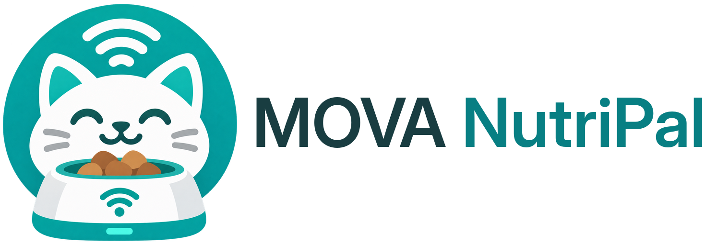

# MOVA NutriPal for Home Assistant

<picture>
  <source media="(prefers-color-scheme: dark)" srcset="custom_components/mova_nutripal/brand/dark_logo@2x.png">
  
</picture>

**Experimental — unofficial community integration.** Tested device model: `mova.feeder.q2503` (NutriPal 10 Ultra). EU MOVA cloud; currently uses Europe/Paris for feeding dates. The 0.1.0 read-only version was tested in Home Assistant Core 2026.11.2. The 0.2.x release still requires live validation. No affiliation with MOVA or Dreame.

## Features
- Daily consumption, food bowl weight, dispensing count, desiccant lifetime and device status.
- Hybrid feeding simulation that reserves the remaining autonomous schedule.
- Passive calibration around scheduled meals, with a median of recent accepted measurements.
- Optional manual one-portion supplement, disabled by default, with persistent lock on uncertain results.
- Automatic supplementation remains **simulation only**. No schedule changes are sent.

Keep an adequate independent feeding plan, verify that scheduled feeding works without internet, and monitor pets directly. Do not rely on this software as the sole food supply. Total distributed weight is an estimate; intake and distribution are different metrics. The configurable 100 g is not nutrition advice.

## Installation (HACS)
After a GitHub release is published, open HACS > Custom repositories and add `https://github.com/GuillaumeBerland/ha-mova-nutripal` as an Integration. Download a release, restart Home Assistant and add MOVA NutriPal in Settings > Devices & services. Existing users: back up HA, update the existing component and restart; do not remove the config entry or stored calibration. Keep manual dispensing disabled until verified. Do not bypass a command lock without checking the feeder physically.

## Scheduled meal calendar
The native read-only calendar projects the current supported daily kibble schedule for today and the following 59 days. No additional cloud calls, no schedule writes, and no historical reconstruction. Unsupported repeat types, expired or invalid schedules are unavailable rather than guessed. Ambiguous or nonexistent local times during daylight-saving transitions are omitted. Events are one-minute calendar markers, not confirmed dispensing or measured durations. Use the calendar for information, not feeding automation.

## Dashboard
A native, read-only dashboard is available in a responsive Sections layout or as a single card. See [dashboard instructions](dashboard/README.md) to generate it with your actual entity IDs (French or English). The optional camera opens on demand; no extra frontend plugin or global theme is required.

## Development
Before the first publication, run `bash prepare.sh` using the existing local upstream clone (optionally supply its path). It exports the three pinned transport files and the original license. They must be committed; HACS users do not run the script. Run `python3 -m unittest discover -s tests -v`. Tests do not connect to MOVA or dispense food. HACS and live HA validation remain separate checks.

Report issues without tokens, passwords, device identifiers, camera URLs or private logs. See [THIRD_PARTY_NOTICES.md](THIRD_PARTY_NOTICES.md) and [CHANGELOG.md](CHANGELOG.md).

## Français
Intégration non officielle et expérimentale pour la NutriPal 10 Ultra. Le mode hybride automatique reste en simulation. La calibration passive et le complément manuel doivent être validés dans HA avant utilisation. Conserver le programme autonome adapté aux animaux. Installation via un dépôt personnalisé HACS après publication d'une release ; redémarrer HA sans supprimer l'intégration existante. Le code Dreame et sa licence sont intégrés avant la première publication.

## Assisted calibration

Keep automatic supplementation in simulation and manual dispensing disabled. In Developer Tools > Actions, select `mova_nutripal.add_calibration_measurement` and target only the **Valid calibration samples** sensor. Enter the actual number of portions, the local MOVA date, the cumulative daily portion counter immediately after the measured distribution, and the kibble-only weight before/after (same tare). Confirm no food was eaten, added or removed between weighings. No food is dispensed by this action. The action saves locally, then requests one normal coordinator refresh.

Example: 5 portions, 0 g before and 34 g after, daily counter 12, on 2026-11-24 gives 6.8 g per portion. Do not enter the example for a different event. Samples must be 2–20 g per portion, and dates must be within the last 30 days. Overlapping portion-counter ranges on the same day are rejected among the 15 retained samples, across assisted and passive sources. Older legacy samples are preserved but have no event identity. Only record a weighing once; do not reuse an evicted measurement. The last 15 accepted samples share one unweighted median, applied only with calibration enabled and at least three valid samples. Reset calibration removes both kinds of samples. The existing reference weight is not changed automatically. The calibration samples sensor exposes the retained sample details and source counts.
